# Renac local

Your Renac N3-HV hybrid inverter in Home Assistant, read in your own
network. The integration talks to the inverter's WiFi module, the
HF-LPT270 inside the inverter, and shows what the inverter does: solar,
battery, grid, house, energy counters, faults. It is read-only: it never
changes a setting of the inverter.

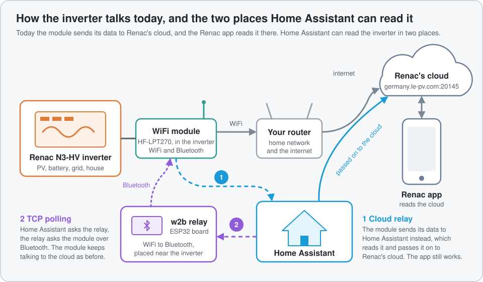

## What you need

| | |
|---|---|
| Inverter | A Renac N3-HV hybrid inverter with its HF-LPT270 WiFi module, connected to your home network. Made for and tested with the N3-HV series; other Renac inverters with the same module are untested |
| Home Assistant | 2026.9 or newer; HACS for the install |
| For the cloud relay | Nothing more. Home Assistant must be reachable from the module: a fixed IP address, or a name your router answers |
| For TCP polling | A bridge that offers the module's Bluetooth link as a TCP port, placed in Bluetooth range of the inverter: the [w2b relay](https://github.com/X-Stuff/esp32-ble-relay) on an ESP32 board, or any other TCP to Bluetooth LE bridge |

## Install

With [HACS](https://hacs.xyz):

1. HACS, the three dots at the top right, **Custom repositories**.
2. Repository `https://github.com/X-Stuff/ha-renac-integration`, type
   **Integration**, Add.
3. Search for **Renac local**, Download, then restart Home Assistant.

Without HACS: copy the folder `custom_components/renac_local` of this
repository into the `custom_components` folder of your Home Assistant
configuration and restart.

## Set up

Settings, Devices & services, Add integration, **Renac local**. Nothing
changes on the module before you agree to it.

### Find the module

Next searches your network for the inverter's WiFi module and lists the
ones that answered. Modules often miss a search: choose Search again, or
Other IP address and type it; your router's list of devices shows it.
Then Home Assistant asks the module which cloud address it uses and keeps
it as the cloud to relay to.

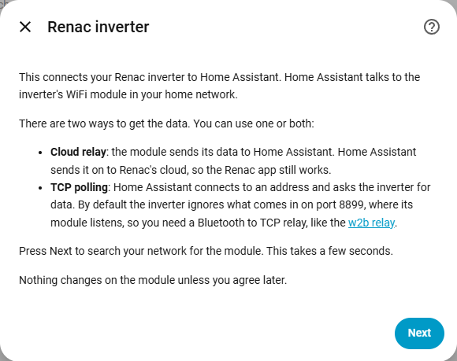

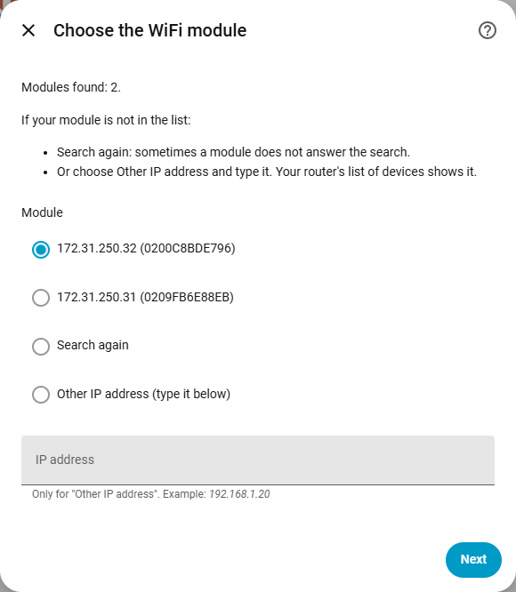

### Choose the way

### Which one?

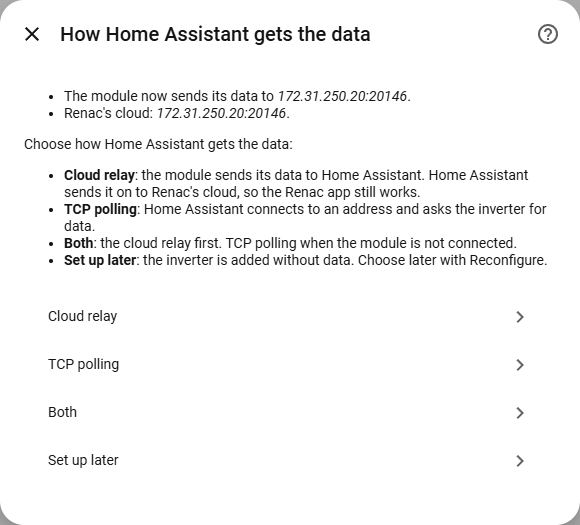

| | Cloud relay | TCP polling |
|---|---|---|
| Hardware | none | a TCP to Bluetooth bridge, the w2b relay for one |
| Changes on the module | one setting: the address it sends its data to | none |
| The Renac app | works through Home Assistant. Changing inverter settings from the app is blocked unless you allow it in Settings | works as before, over the cloud. Its Bluetooth connection is busy while the relay holds the link |
| When Home Assistant is off | the app gets no new data until it is back | nothing changes for the app |
| Readings | every 30 s, on the connection the module keeps open | every 30 s; each reading brings the Bluetooth link up, unless the relay keeps it up |

With **both**, the cloud relay comes first, and TCP polling reads while
the module is not connected.

### Cloud relay

The module sends everything to one address, normally Renac's cloud. With
the cloud relay, the module sends its data to Home Assistant instead.
Home Assistant reads the inverter on that connection and passes the
cloud's traffic on, so the Renac app keeps working. Nothing to buy.

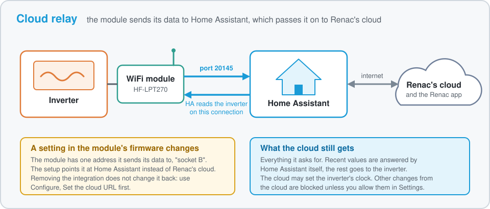

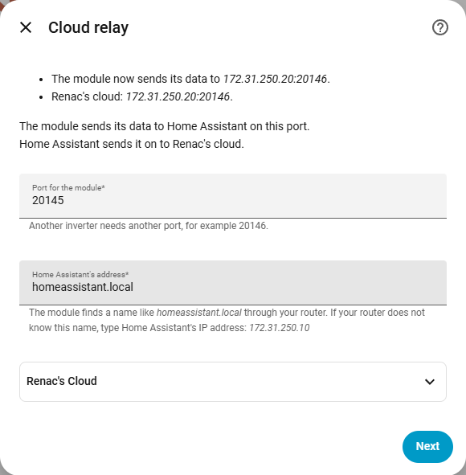

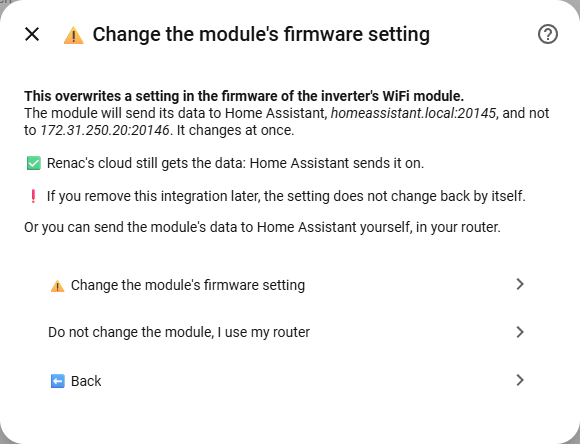

The port the module connects to, 20145, and Home Assistant's address.
The module finds a name like `homeassistant.local` only through your
router; if your router does not know the name, type Home Assistant's IP
address, which the form shows. Then the warning: **Change the module's
firmware setting** points the module at Home Assistant, and Home
Assistant waits up to 30 s for the module to connect. If it does not:
wait again, revert, or keep it. Or leave the module as it is and redirect
its traffic in your router.

### TCP polling

Home Assistant asks the inverter through the relay, over Bluetooth.
Nothing changes on the module, and the Renac app keeps its cloud
connection as before. You need the relay board.

Why a relay: the WiFi module itself listens on TCP port 8899, but it
answers nothing there. The inverter can be asked only over the module's
Bluetooth, so something has to turn that Bluetooth link into a TCP port.
That is what the w2b relay does.

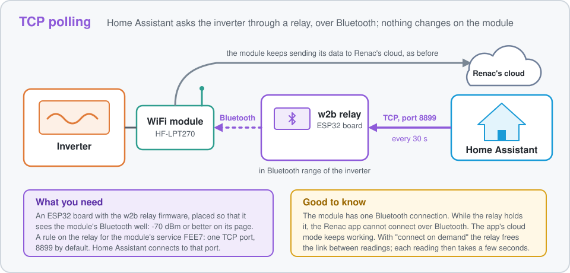

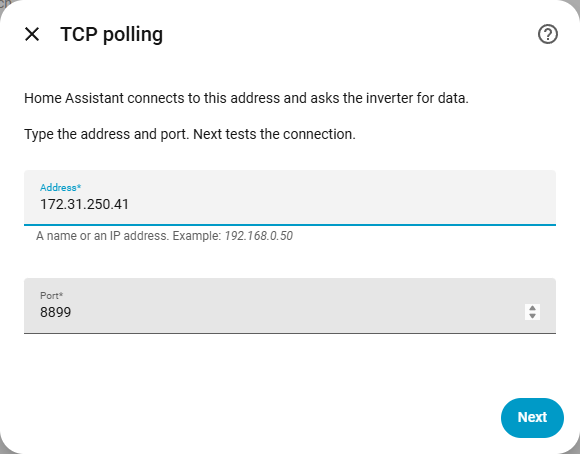

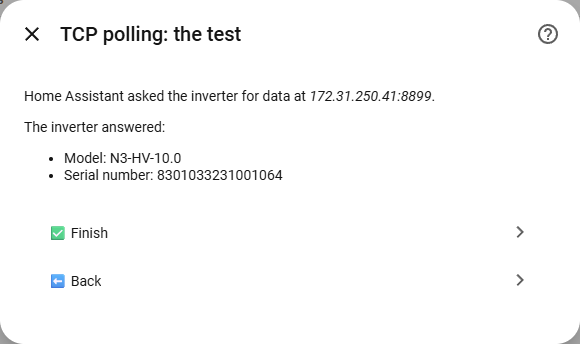

The relay's address and port, `8899` by default. Next tests the
connection and shows the inverter's model and serial number, or why not.
Finish.

With the w2b relay, the inverter's device gets two more entities,
**Relay battery**, a percentage, and **Relay battery voltage**, read from
the relay's own page every 5 minutes. The percentage is the relay's
estimate from the voltage, the same its page shows.

### Done

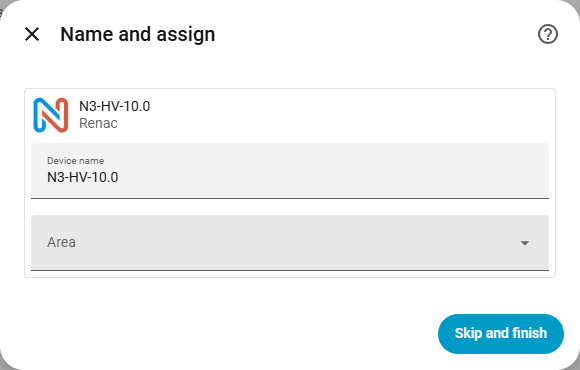

The inverter is named `Renac <module IP>` first, then `Renac <model>
<serial number>` once it has answered. Its entities appear within a
minute. If nothing comes after a minute, Settings, Repairs tells you why.

## What you get

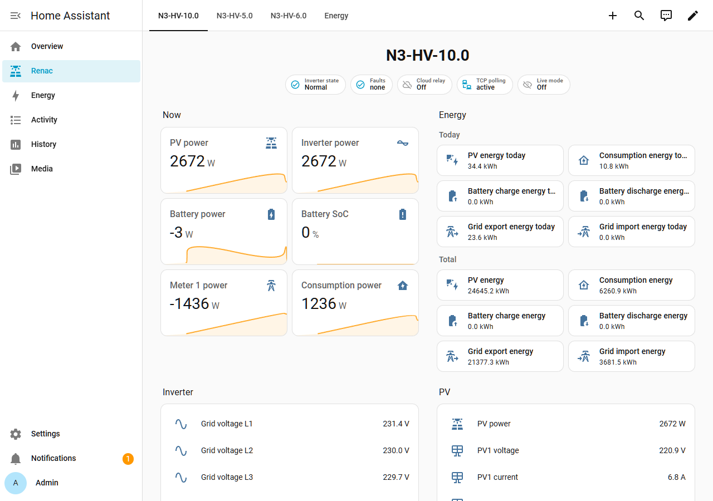

The dashboard **Renac** in the sidebar, one tab per inverter: the state,
the faults, the two ways in, the relay's battery when there is one, and
Live mode at the top; the powers and the
battery level now, each with its day; the energy counters of today and of
the inverter's life; today's power and battery level as graphs; the
inverter, PV, battery and energy counter lists. The Live mode badge opens the live view, where
the switch reads the live data every 5 s for a minute.

The dashboard follows your entities: a new inverter gets its tab, an
entity you turn on appears in its list. You can edit it like any
dashboard; from your first change on, the integration leaves it alone.
Configure, **Rebuild the Renac dashboard** builds it again, replacing
your changes.

## Changing things later

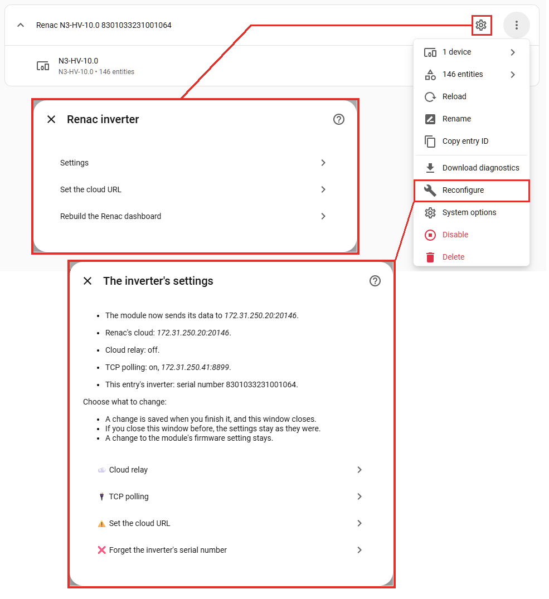

**Configure**, the gear:

- **Settings:** how often the live data, the energy counters and the
  inverter settings are read; live mode's intervals and when it turns
  itself off; the optional register groups, 32-bit powers, protection
  settings and undocumented registers; TCP polling's quiet time after
  the cloud's requests; whether the cloud relay passes the cloud's writes
  to the inverter. Advanced, collapsed: the timeouts and a few more. Save
  restarts the connection with the new settings.
- **Set the cloud URL:** where the module sends its data, as
  `address:port`. Shown only for a module that has answered Home
  Assistant. Submit changes the module's firmware setting at once.
  Renac's cloud is `germany.le-pv.com:20145`.
- **Rebuild the Renac dashboard:** builds the dashboard again from the
  entities, replacing your changes to it.

**Reconfigure**, in the three-dot menu. It first reads the module's
setting and shows where the module sends its data, then:

- **Cloud relay:** turn it on, change its port and Home Assistant's
  address, or turn it off. Turning it off while the module sends its
  data to Home Assistant offers to set the module back to Renac's cloud
  first.
- **TCP polling:** turn it on, change the address and port, with the
  connection test, or turn it off.
- **Set the cloud URL:** the same as in Configure.
- **Forget the inverter's serial number:** for a new inverter behind the
  same module. The entry takes the serial number of the inverter at the
  next connection.

Each change is saved when you finish it, and the window closes. Closing
the window before keeps everything as it was.

## Before you remove the integration

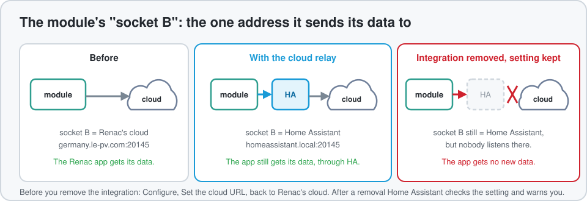

Removing the integration does not point the module back at Renac's
cloud. If you used the cloud relay: Configure, Set the cloud URL, back
to Renac's cloud, `germany.le-pv.com:20145`, then remove the inverter.
After a removal Home Assistant reads the module's setting once more and
warns you with a notification when it still points somewhere else.

## Good to know

- **One setting of the module changes, with your consent.** The cloud
  relay's setup, Set the cloud URL and the reconfigure can change where
  the module sends its data. Every such step says so before you press
  the button. Nothing else on the module is ever changed.
- **The Renac app with the cloud relay.** The app reads the cloud, and
  the cloud gets its data through Home Assistant, so the app keeps
  showing the inverter. Changing the inverter's settings from the app
  goes through the cloud too: by default Home Assistant blocks those
  changes, lets the cloud set the inverter's clock only, and lists what
  it blocked in a notification. Configure, Settings, "pass the cloud's
  writes" lets them through. Every such write, blocked or passed, also
  fires the event `renac_local_cloud_write`, for your automations.
- **Home Assistant must stay reachable for the module.** With the cloud
  relay, the module connects to Home Assistant by the address you gave.
  Give Home Assistant a fixed IP address in your router, or a name the
  router answers. While Home Assistant is off, the app gets no new data.
- **The module answers only inside its own network.** The search and the
  reading of its setting work from the same subnet as the module. With
  VLANs, or Home Assistant in Docker on a bridge network, type the
  module's IP address and expect no answer: then only TCP polling can be
  set up, and the cloud relay works with a redirect in your router.
- **Do not send the module other commands yourself.** The integration
  sends the module three commands: a greeting, the read or set of its
  cloud address, and the goodbye. A wrong command can freeze the
  module's network side until the inverter is powered off and on.
- **Bluetooth.** The module has one Bluetooth connection. While the relay
  holds it, the Renac app cannot connect over Bluetooth; its cloud mode
  is not affected. Place the relay so it sees the module at -70 dBm or
  better, its page shows the number; at -80 dBm readings start to fail.
  The relay's "connect on demand" frees the link between readings and
  each reading then takes a few seconds; "always" keeps it up.
- **Your data stays home.** Nothing leaves your network except what the
  cloud relay passes on to Renac's cloud, which is exactly what the
  module sent there before.

## When something does not work

- **Settings, Repairs says the inverter has not answered yet.** Its text
  tells why: the module not connected to the port, or TCP polling's last
  error. Next opens the inverter's settings.
- **Cloud relay stays "waiting".** The module does not reach Home
  Assistant: the address it dials is not Home Assistant's, or your
  router does not answer the name. Reconfigure shows where the module
  sends its data; Set the cloud URL fixes it, with Home Assistant's IP
  address.
- **TCP polling "failing".** The relay is off, or its address or port is
  wrong, or its Bluetooth link to the module fails: look at the relay's
  page and log. "Refused" means another inverter answers: Forget the
  inverter's serial number if you changed the inverter.
- **The Renac app shows no new data.** The module sends its data to Home
  Assistant but the cloud relay is off, or Home Assistant is off. Set
  the cloud URL back to Renac's cloud, or turn the cloud relay on.
- **For a bug report:** the inverter's three-dot menu, Download
  diagnostics. The file holds the connection counters and the values,
  with the inverter's serial number removed. Settings, System, Logs,
  search `renac_local`.

## For developers

The code layout, the tests, the test instance with its fake inverter,
and the command-line tools: [docs/DEVELOPING.md](docs/DEVELOPING.md).
The design and its reasons: [docs/DESIGN.md](docs/DESIGN.md). The
protocol as recovered: [docs/PROTOCOL.md](docs/PROTOCOL.md).

## License and credits

GNU General Public License v3.0 or later, [LICENSE](LICENSE).

The icon and logo in `custom_components/renac_local/brand/` are Renac's,
taken from [gastush/ha-renac](https://github.com/gastush/ha-renac), the
cloud integration for Renac inverters.
